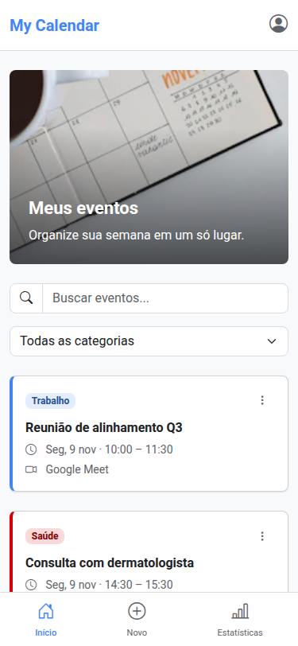
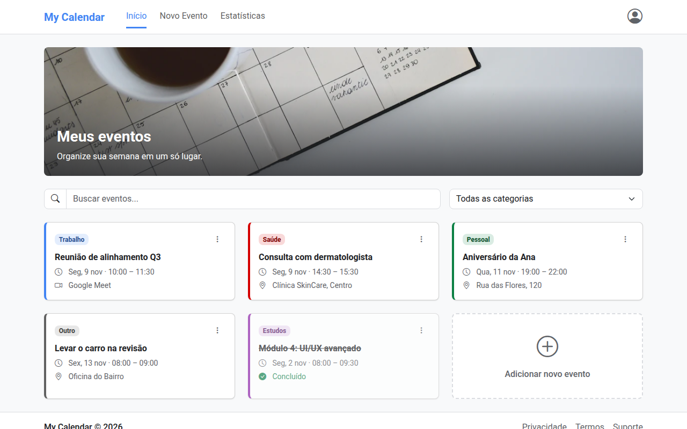
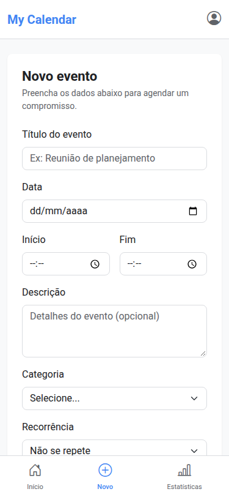
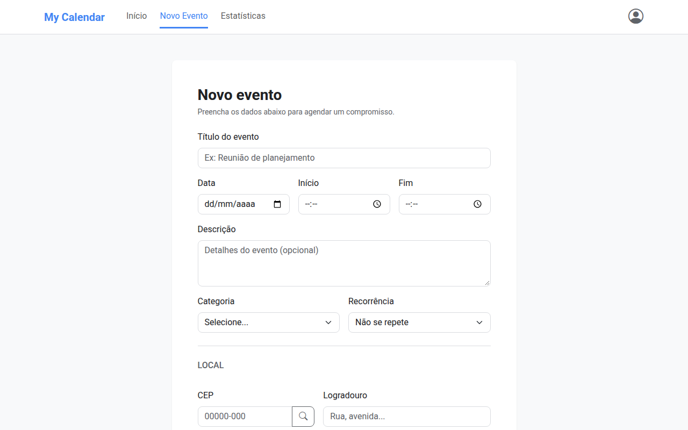
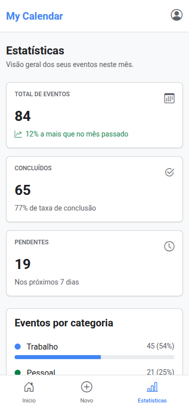
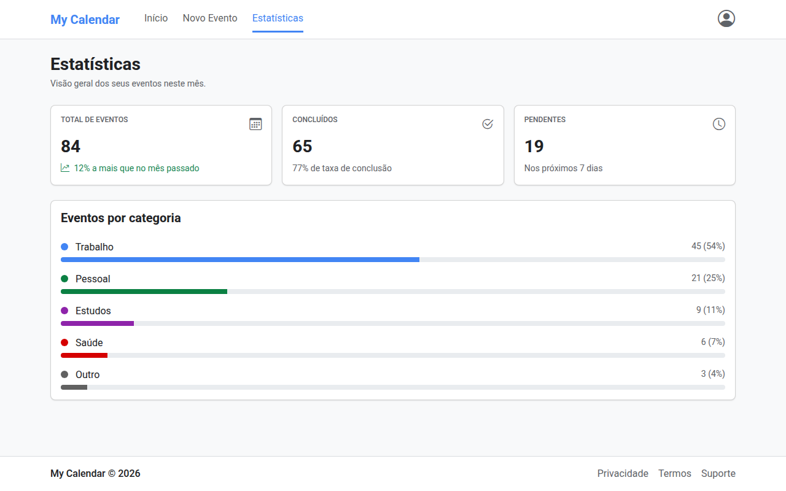

# my-calendar

### **Autor:** Vinicius Liepienski de França

Este projeto tem como objetivo implementar uma agenda pessoal web, em que o usuário cria, visualiza, edita e exclui seus compromissos. Os eventos aparecem como cards coloridos por categoria, com busca, filtro, marcação de conclusão, recorrência, endereço preenchido pelo CEP e uma página de estatísticas.

O frontend da aplicação foi desenvolvido com HTML, Sass (Bootstrap) e JavaScript, e o backend será simulado pela implementação de uma API Fake, usando o JSON Server.

## 📚 Documentação do Projeto

Para entender as regras de negócio, o escopo e a arquitetura técnica da aplicação, consulte os documentos abaixo:

- [📄 Product Requirements Document (PRD)](./docs/prd.md) - Visão geral, atores, histórias de usuário e regras de negócio.
- [🛠️ Especificação Técnica (Tech Spec)](./docs/architecture.md) - Diagrama de banco de dados (DER), dicionário de dados e rotas da API (JSON Server).

## 🎨 Design

- [🎨 Design System](./docs/design-system.md) - Identidade visual
- [🖼️ Protótipo no Stitch](https://stitch.withgoogle.com/projects/6869356017674285767) - Telas da aplicação no celular e no desktop.

## 🌐 Site em Produção - GitHub Pages

A partir da Entrega 3.

## 💻 Tecnologias e Dependências

- **Framework CSS:** Bootstrap 5.3.8, personalizado com Sass
- **Ícones:** Bootstrap Icons
- **JavaScript:**
  - **JQuery** - Para realizar animações e manipulação do DOM.
  - **JSON Server** - Para simular uma API REST.
- **APIs públicas:** ViaCEP (endereço a partir do CEP) e Date Nager (feriados nacionais)

## ✅ Checklist | Indicadores de Desempenho (ID) dos Resultados de Aprendizagem (RA)

#### RA1 - Utilizar Frameworks CSS para estilização de elementos HTML e criação de layouts responsivos.

- [x] ID 01 - Prototipa interfaces adaptáveis para no mínimo os tamanhos de tela mobile e desktop, usando ferramentas de design tradicionais (Figma, Quant UX ou Sketch) ou IA (Stitch).
- [x] ID 02 - Implementa layout responsivo com Framework CSS (Bootstrap, Materialize) usando Flexbox ou Grid do próprio framework.
- [x] ID 03 - Implementa layout responsivo com CSS puro, usando Flexbox ou Grid Layout.
- [x] ID 04 - Utiliza componentes prontos de um Framework CSS (ex.: card, button) e componentes JavaScript do framework (ex.: modal, carousel).
- [x] ID 05 - Cria layout fluido usando unidades relativas (vw, vh, %, em, rem) no lugar de unidades fixas (px).
- [x] ID 06 - Aplica um Design System consistente (cores, tipografia, padrões de componentes) em toda a aplicação.
- [x] ID 07 - Utiliza Sass (SCSS) com ou sem framework, aplicando variáveis, mixins e funções para modularizar o código.
- [x] ID 08 - Aplica tipografia responsiva (media queries mobile first) ou tipografia fluida (função clamp() + unidades relativas).
- [x] ID 09 - Aplica técnicas de responsividade de imagens usando CSS (object-fit, containers com unidades relativas).
- [x] ID 10 - Otimiza imagens usando formatos modernos (WebP) e carregamento adaptativo (srcset, picture, ou parâmetros do Cloudinary).

#### RA2 - Realizar tratamento de formulários e aplicar validações customizadas no lado cliente.

- [ ] ID 11 - Implementa validação HTML nativa (campos obrigatórios, tipos, limites de caracteres) com mensagens de erro/sucesso no lado cliente.
- [ ] ID 12 - Aplica expressões regulares (REGEX) para validações customizadas (e-mail, telefone, datas, etc.)
- [ ] ID 13 - Utiliza elementos de seleção em formulários (checkbox, radio, select) para coleta de dados.
- [ ] ID 14 - Implementa leitura e escrita no Web Storage (localStorage/sessionStorage) para persistir dados localmente.

#### RA3 - Aplicar ferramentas para otimização do processo de desenvolvimento web.

- [x] ID 15 - Configura ambiente com Node.js e NPM para gerenciamento de pacotes e dependências.
- [x] ID 16 - Utiliza boas práticas de versionamento no Git/GitHub (branch main ou branches específicos, uso de .gitignore).
- [ ] ID 17 - Mantém um README.md padronizado, conforme template da disciplina, com checklist preenchido.
- [ ] ID 18 - Organiza arquivos do projeto de forma modular, seguindo padrão de exemplo fornecido.
- [ ] ID 19 - Configura linters e formatadores (ESLint, Prettier) para manter qualidade e padronização do código.

#### RA4 - Aplicar bibliotecas de funções e componentes em JavaScript para aprimorar a interatividade de páginas web.

- [ ] ID 20 - Utiliza jQuery para manipulação do DOM e interatividade (eventos, animações, manipulação de elementos)
- [ ] ID 21 - Integra e configura um plugin jQuery relevante (ex.: jQuery Mask Plugin) ou outra biblioteca de funções.

#### RA5 - Efetuar requisições assíncronas para uma API fake e APIs públicas, permitindo a obtenção e manipulação de dados dinamicamente.

- [ ] ID 22 - Realiza requisições assíncronas para uma API fake (ex.: JSON Server) para persistir dados de um formulário.
- [ ] ID 23 - Realiza requisições assíncronas para uma API fake para exibir dados na página.
- [ ] ID 24 - Realiza requisições assíncronas para APIs públicas reais (OpenWeather, ViaCEP etc.), exibindo os dados e tratando erros.

## 🚀 Manual de execução

- Clonar o repositório com `git clone https://github.com/Vinicius-L-Franca/my-calendar.git` (a branch `main` tem a versão mais recente)
- Abrir a pasta do projeto no editor Visual Studio Code (VS Code)
- Abrir um terminal no VS Code, apontando para a pasta raiz do projeto
- Instalar as dependências contidas no `package.json`
  - Comando: `npm i`
- Abrir o `index.html` com a extensão **Live Server** do VS Code
  - O CSS já vem compilado em `assets/css/main.css`; não é preciso rodar o Sass só para ver o site
- Para alterar os estilos, editar os arquivos de `assets/scss/` e gerar o CSS de novo
  - Comando: `npm run sass` (ou `npm run sass:watch`, que recompila a cada alteração)
- A API Fake (JSON Server) entra a partir da Entrega 3, com o comando para executá-la

## 📱 Telas da aplicação

A foto do banner é do [Unsplash](https://unsplash.com/license) (uso livre).
