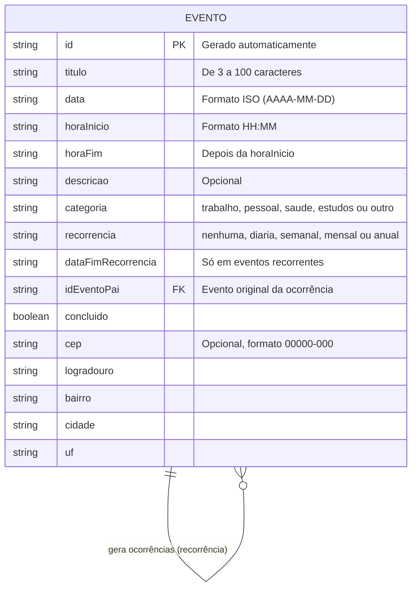

# 🛠️ Especificação Técnica (Tech Spec) - My Calendar

Este documento detalha o modelo de dados e os contratos de API (via JSON Server) necessários para o funcionamento da agenda My Calendar.

## 1. Modelo de Dados (Diagrama ER)

Abaixo está o Diagrama Entidade-Relacionamento (DER) que representa a estrutura do nosso "banco de dados" (`db.json`). A agenda tem uma única entidade, o evento, que se relaciona com ela mesma para representar a recorrência.



## 2. Dicionário de Dados

Breve explicação da tabela principal:

- **Eventos:** Cada compromisso da agenda. Guarda o que vai aparecer no card da página inicial e alimenta os números da página de estatísticas.
  - id: Identificador único gerado pelo JSON Server.
  - titulo: Obrigatório, de 3 a 100 caracteres (RN-01).
  - data, horaInicio e horaFim: Data no formato AAAA-MM-DD e horas no formato HH:MM. A horaFim precisa ser depois da horaInicio (RN-02 e RN-05).
  - categoria: Aceita apenas os valores "trabalho", "pessoal", "saude", "estudos" ou "outro" (RN-06). Define a cor do card.
  - recorrencia: Aceita apenas "nenhuma", "diaria", "semanal", "mensal" ou "anual".
  - dataFimRecorrencia: Até quando o evento se repete. Obrigatória quando a recorrência não é "nenhuma"; caso contrário, fica `null` (RN-03).
  - idEventoPai: Chave estrangeira que liga cada ocorrência gerada ao evento original. No evento original, fica `null`. Cada ocorrência é um evento completo, que pode ser editado ou excluído sozinho (RN-07).
  - concluido: `true` ou `false`. Marcar ou desmarcar não altera os outros campos (RN-09).
  - cep, logradouro, bairro, cidade e uf: Endereço opcional do evento. Ao informar o CEP, os outros campos são preenchidos pela API ViaCEP (RN-08).

## 3. Rotas da API (JSON Server)

A aplicação consome a API local simulada pelo JSON Server. Abaixo os principais endpoints:

- `GET /eventos` - Retorna todos os eventos (lista da página inicial e números das estatísticas).
- `GET /eventos?categoria=trabalho` - Retorna só os eventos de uma categoria (filtro da página inicial).
- `GET /eventos/1` - Retorna um evento específico, para preencher o formulário de edição.
- `POST /eventos` - Cadastra um novo evento (formulário Novo Evento).
- `PUT /eventos/1` - Salva todas as alterações de um evento editado no formulário.
- `PATCH /eventos/1` - Atualiza só o campo `concluido` (marcar ou desmarcar como concluído).
- `DELETE /eventos/1` - Exclui um evento, depois da confirmação no modal.
- `GET /eventos?idEventoPai=1` - Retorna as ocorrências de um evento recorrente, para excluir "esta e todas as futuras" (RN-04).

Os nomes das rotas são os nomes das coleções do `db.json` (seção 4): `eventos`. Os filtros `?categoria=` e `?idEventoPai=` usam os mesmos nomes dos campos do evento.

A aplicação também consome duas APIs públicas, que não precisam de chave de acesso:

- `GET https://viacep.com.br/ws/{cep}/json/` - Retorna o endereço do CEP digitado no formulário. Para um CEP que não existe, responde com `"erro": true`.
- `GET https://date.nager.at/api/v3/PublicHolidays/{ano}/BR` - Retorna os feriados nacionais do ano, com o nome em português (`localName`), para o aviso de feriado no card (US-12).

## 4. Estrutura do Banco de Dados (db.json)

Esta é a representação em formato JSON do banco de dados simulado. Esta estrutura serve de contexto para ferramentas de IA e para o JSON Server inicializar a API Fake. O evento 3 é uma ocorrência gerada a partir do evento 2.

```JSON
{
  "eventos": [
    {
      "id": "1",
      "titulo": "Reunião de alinhamento",
      "data": "2026-11-09",
      "horaInicio": "10:00",
      "horaFim": "11:30",
      "descricao": "Revisão das metas do trimestre",
      "categoria": "trabalho",
      "recorrencia": "nenhuma",
      "dataFimRecorrencia": null,
      "idEventoPai": null,
      "concluido": false,
      "cep": null,
      "logradouro": null,
      "bairro": null,
      "cidade": null,
      "uf": null
    },
    {
      "id": "2",
      "titulo": "Aula de inglês",
      "data": "2026-11-10",
      "horaInicio": "18:00",
      "horaFim": "19:00",
      "descricao": "",
      "categoria": "estudos",
      "recorrencia": "semanal",
      "dataFimRecorrencia": "2026-12-15",
      "idEventoPai": null,
      "concluido": true,
      "cep": "80020-000",
      "logradouro": "Rua XV de Novembro",
      "bairro": "Centro",
      "cidade": "Curitiba",
      "uf": "PR"
    },
    {
      "id": "3",
      "titulo": "Aula de inglês",
      "data": "2026-11-17",
      "horaInicio": "18:00",
      "horaFim": "19:00",
      "descricao": "",
      "categoria": "estudos",
      "recorrencia": "semanal",
      "dataFimRecorrencia": "2026-12-15",
      "idEventoPai": "2",
      "concluido": false,
      "cep": "80020-000",
      "logradouro": "Rua XV de Novembro",
      "bairro": "Centro",
      "cidade": "Curitiba",
      "uf": "PR"
    }
  ]
}
```
